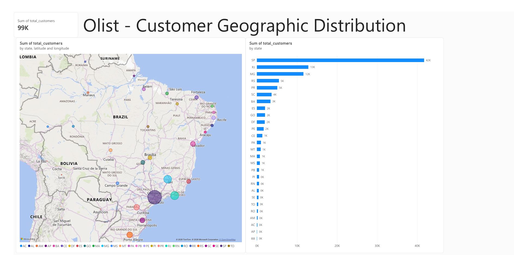

# Brazilian E-Commerce Customers SQL Analysis

## Project Overview
This project contains basic exploratory data analysis (EDA) on the `customers` dataset from Olist using MySQL.

## Key Insights & Queries
- Checked total customer records and table schema.
- Filtered customers by state (`SP`).
- Identified unique states across Brazil.
- Used pattern matching (`LIKE`) to find customers in cities like Rio.
  ---

## 🗺️ Geospatial Analysis & Interactive Dashboard

This section covers the end-to-end data pipeline from raw GPS coordinates in MySQL to an interactive executive dashboard built in Power BI.

### 1. Database Optimization & SQL Queries
- Cleaned and bulk-loaded 1,000,000+ rows of raw coordinate data.
- Built B-Tree indexes on zip code prefix columns, reducing heavy cross-table join query execution time from 210s down to 10s.
- Aggregated customer geographic density and calculated centroid GPS points for Brazilian states.

🔗 **[View Geolocation SQL Script](./02_geolocation_analysis.sql)**

---

### 2. Power BI Executive Dashboard
- **Geographic Bubble Map:** Visualizes geographic concentration of customers across Brazil.
- **State Rankings:** Sorted horizontal bar chart showing customer count per state.
- **Dynamic Cross-Filtering:** Interactive slicing between state-level metrics and geospatial map bubbles.

### 🖼️ Dashboard Preview

---

### 📂 Deliverables & Downloads
- 📥 **[Download Full PDF Report](./Olist_Customer_Geographic_Analysis.pdf)**
